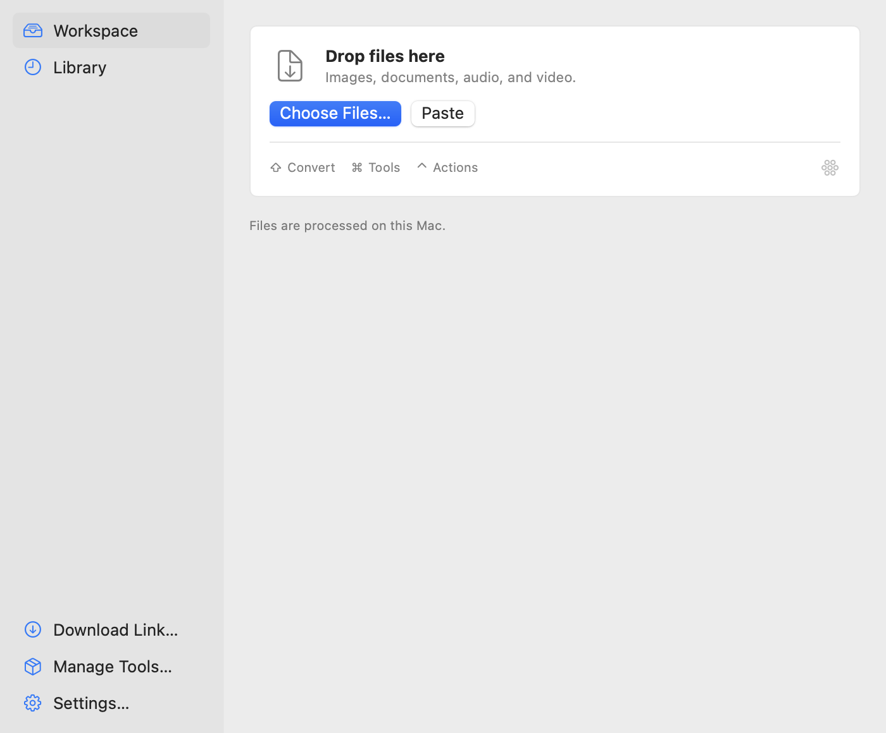

# Twister

Native file tools for macOS. Convert, edit and prepare images, PDFs, documents, audio and video without moving between separate apps.

**Apple Silicon · macOS 13 or later · English and Turkish**



## Features

- Convert individual files or batches using formats supported by the current selection.
- Crop, resize, annotate and frame images, create collages and remove metadata.
- Organize, merge and split PDFs. Undo and redo up to 50 page or annotation edits.
- Preview and trim audio and video, adjust selection endpoints and export clips.
- Choose a saved output folder or keep results beside the original files.
- Search recent results in Library, preview them and use them in another operation.
- Download supported public media links and continue editing the downloaded files.
- Carry files between apps with Float and use optional window arrangement tools.

File conversion and editing run on your Mac. Original files are preserved, output names avoid collisions, and a failed batch removes its unfinished exports. Media downloads and optional tool setup require a network connection.

## Build and run

Install Xcode with Swift 6, Python 3 and Node.js 22 or later. Run the setup commands from the repository folder:

```sh
git clone https://github.com/baypeanut/twister.git
cd twister
scripts/setup-exiftool.sh
python3 scripts/setup-resources.py
scripts/build-app.sh release
open build/Twister.app
```

The application is created at `build/Twister.app`. Dependency resources are downloaded from pinned sources and verified with SHA-256. The in-app setup screen can install optional media and Office tools when needed.

Local builds use an ad-hoc signature. There is no notarized installer or configured automatic update channel yet.

## Daily use

Choose files, drop them into the workspace or paste supported clipboard content. Pick a quick conversion or open the tools menu. The output folder appears above the file actions and in editor footers.

Click the menu-bar icon to open Twister. Click it again, press Escape or switch to another app to dismiss the workspace. Background operations continue when the interface is hidden.

| Action | Shortcut |
| --- | --- |
| Choose files | ⌘O |
| Paste files, an image, text or a link | ⌘V |
| Library | ⌘2 |
| Search Library | ⌘F |
| Undo / redo a PDF or annotation edit | ⌘Z / ⇧⌘Z |
| Play / pause media preview | Space |
| Mark selection start / end | I / O |
| Settings | ⌘, |
| Minimize | ⌘M |
| Dismiss workspace | Escape |

While dragging files in Finder, Shift opens conversions, Command opens tools and Control opens file actions. These shortcuts are configurable. Finder gestures and window arrangement use the relevant macOS permissions; choosing files in the workspace remains available independently.

## Command line

```sh
swift build --product twister-cli
.build/debug/twister-cli catalog
.build/debug/twister-cli convert png "holiday photo.jpg"
.build/debug/twister-cli inspect photo.png
```

The CLI supports `convert`, `tool`, `inspect`, `dependencies`, `catalog` and JSON options. With the optional runtimes installed, `twister-cli dependencies` prints the resolved conversion-tool paths; a missing dependency returns an error. The app and CLI have separate executable names so both can be built on the default macOS filesystem. Add `--json` to a conversion or tool command to print the output paths as a JSON array:

```sh
.build/debug/twister-cli convert png photo.jpg --json
```

## Development and verification

```sh
swift build --product Twister
python3 scripts/setup-test-fixtures.py
swift test --parallel
python3 scripts/test-product-identity.py
python3 scripts/test-native-ui.py
python3 scripts/test-workflows.py
python3 scripts/test-web-download-integration.py
python3 scripts/generate-localizations.py --check
```

The full conversion suite requires FFmpeg, FFprobe, ExifTool and LibreOffice. Native interface tests need a logged-in macOS desktop. Provider-specific live tests are opt-in.

See the [development guide](CONTRIBUTING.md), [dependency setup](docs/dependencies.md) and [native verification guide](docs/testing/UI-AUDIT.md) for details.
