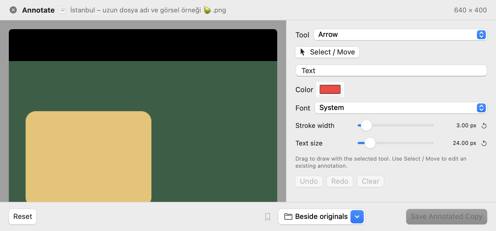
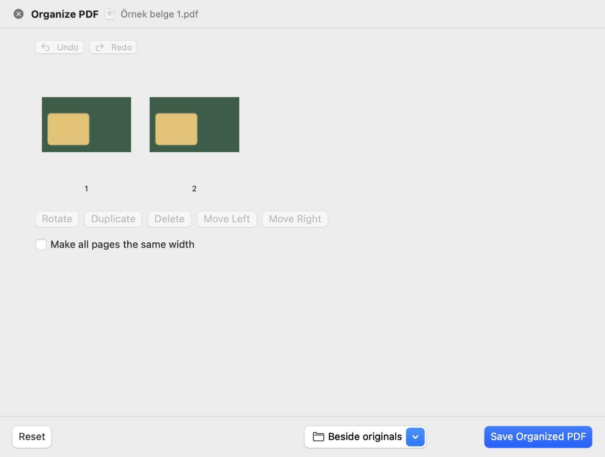

<p align="center">
  
</p>

<h1 align="center">Twister</h1>

<p align="center"><strong>Native file tools for macOS.</strong></p>

<p align="center">Apple silicon · macOS 13 or later · English and Turkish</p>

Twister converts and edits images, PDFs, documents, audio and video in one place. Drop files on it, pick what you want, and the result appears beside the originals or in a folder you choose. Everything runs on your Mac.

<picture>
  <source media="(prefers-color-scheme: dark)" srcset="docs/screenshots/workspace-dark.png">
  
</picture>

## What it does

| | |
| --- | --- |
| **Images** | Convert, crop, resize, annotate and frame images, make collages and remove metadata. |
| **PDFs** | Organize, merge, split and compress PDFs, with up to 50 steps of undo. |
| **Audio and video** | Preview and trim clips, adjust the start and end, and export. |
| **Documents** | Convert office documents, EPUB and Pages files. |
| **Batches** | Convert many files at once; each file is handled on its own. |
| **Presets** | Save an operation with its options and run it again from the app, Finder or Terminal. |
| **Library and Float** | Find recent results, and carry files between apps. |

Choose a tool from the wheel. Twister only offers what fits every selected file.

<p align="center">
  
</p>

Editors keep their options on the side and save a copy, never over the original.





### Safe with your files

- Original files are never changed, and output names never overwrite an existing file.
- In a batch, a file that fails leaves nothing half-finished behind, and the files that succeeded stay in place.
- Operations that combine their inputs, such as merging PDFs or joining videos, finish as a whole or not at all.

### Optional extras

Both are off until you turn them on in **Settings → General**:

- **Web downloads** save media from public links and install their own tools.
- **Window arrangement** still works but is no longer being extended.

Web downloads and optional tool setup need a network connection; everything else works offline.

## Install

You need Xcode with Swift 6, Python 3 and Node.js 22 or later.

```sh
git clone https://github.com/baypeanut/twister.git
cd twister
scripts/setup-exiftool.sh
python3 scripts/setup-resources.py
scripts/build-app.sh release
open build/Twister.app
```

The app is built at `build/Twister.app`; move it to your Applications folder to keep it. Build resources come from pinned sources and are checked with SHA-256. The media and office tools are installed from inside the app the first time you need them, and each group can be removed again by itself. To build without the web downloader, run `TWISTER_WEB_DOWNLOADS=0 scripts/build-app.sh release`.

> [!NOTE]
> This is a local build signed only for your Mac. It is not notarized and does not update itself; to update, pull the latest changes and build again.

## Daily use

Click the menu bar icon to open Twister. Choose files with ⌘O, drop them on the workspace or paste with ⌘V, then pick a quick conversion or open the tools. Click the icon again, press Escape or switch apps to hide it; work keeps running in the background, and Twister can notify you when it finishes.

A task started while another is running waits its turn. A batch shows each file as waiting, working, done or failed with a reason, and **Retry Failed** runs again only the files that failed.

### Presets

Use **Save as Preset…**, the bookmark button in an editor, to keep a tool with the options you chose. A preset can save beside the originals, to the current output folder or always to one folder. The workspace shows the presets that fit your selection; **Settings → Presets** lists all of them. Passwords typed for protected files are never saved.

### From Finder

Select files in Finder and open **Services**:

- **Open in Twister** sends them to the workspace.
- **Convert with Twister…** opens the conversion wheel.
- **Run Twister Preset…** lists the presets that fit.

The entries appear after Twister has been opened once. To give one a keyboard shortcut, go to **System Settings → Keyboard → Keyboard Shortcuts → Services → Files and Folders**.

While dragging files in Finder, hold **Shift** for conversions, **Command** for tools or **Control** for file actions. These gestures can be changed in Settings.

### Keyboard shortcuts

| Action | Shortcut |
| --- | --- |
| Choose files | ⌘O |
| Paste files, an image, text or a link | ⌘V |
| Library | ⌘2 |
| Search Library | ⌘F |
| Undo / redo a PDF or annotation edit | ⌘Z / ⇧⌘Z |
| Play / pause media preview | Space |
| Mark selection start / end | I / O |
| Settings | ⌘, |
| Dismiss workspace | Escape |

## Command line

`twister-cli` runs the same conversions, tools and presets from Terminal.

```sh
swift build --product twister-cli
.build/debug/twister-cli catalog
.build/debug/twister-cli convert png "holiday photo.jpg"
.build/debug/twister-cli inspect photo.png
```

Commands: `convert`, `tool`, `preset`, `inspect`, `dependencies` and `catalog`. Add `--json` to print the output paths as a JSON array. Finished files go to standard output; each failed file is reported on standard error as `PATH: reason`.

Presets are shared with the app and stored in `~/Library/Application Support/Twister/Presets.json` (set `TWISTER_PRESETS_FILE` to use another file).

```sh
.build/debug/twister-cli preset list
.build/debug/twister-cli preset run "Web JPEG" --json -- photo.png "--odd name.png"
.build/debug/twister-cli preset export "Web JPEG" > web-jpeg.json
.build/debug/twister-cli preset import web-jpeg.json
```

`preset run` takes the same options as `convert`; `--options` changes the saved options for that run only. `import` never replaces a preset: a name that is taken gets a number.

| Exit status | Meaning |
| --- | --- |
| 0 | Every file was exported |
| 1 | Nothing was exported |
| 3 | Some files failed; the others were kept and printed |
| 64 | Usage error |
| 130, 143 | Interrupted; finished exports are kept |

## Guides

| Using Twister | Working on Twister |
| --- | --- |
| [Getting started](docs/guide/getting-started.md) | [Contributing](CONTRIBUTING.md) |
| [Images](docs/guide/images.md) | [Dependencies](docs/dependencies.md) |
| [PDFs](docs/guide/pdfs.md) | [Native verification](docs/testing/UI-AUDIT.md) |
| [Audio and video](docs/guide/media.md) | |
| [Documents](docs/guide/documents.md) | |
| [Archives](docs/guide/archives.md) | |
| [Library and Float](docs/guide/library.md) | |
| [Optional tools](docs/guide/setup.md) | |
| [Troubleshooting](docs/guide/troubleshooting.md) | |

## Development

```sh
swift build --product Twister
python3 scripts/setup-test-fixtures.py
swift test --parallel
python3 scripts/test-native-ui.py
python3 scripts/test-workflows.py
python3 scripts/generate-localizations.py --check
```

The full conversion suite needs FFmpeg, FFprobe, ExifTool and LibreOffice. Interface tests need a logged-in macOS desktop. Tests against live websites are opt-in.

## License

Copyright © 2026 baypeanut. All rights reserved. See [LICENSE](LICENSE).
